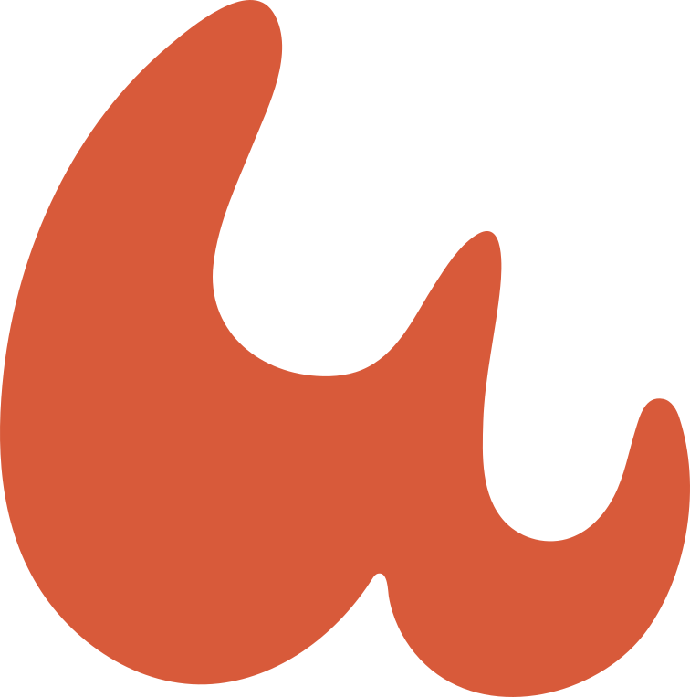

<p align="center">
  
</p>

<h1 align="center">Weloury</h1>

<p align="center">
  A local desktop app for keeping track of what is happening on your machine.
</p>

Weloury brings system information and everyday administration tools into one place. It is being built with a Go backend, a React and TypeScript interface, and a Tauri desktop shell.

The project is still in development. The notes below describe the code that is in the repository today, including the parts that are not ready yet.

## Current status

The Go backend and the frontend have been developed and exercised on Linux. The Go code also has cross-compilation checks for Windows and macOS, but those builds have not been run on real machines.

**The complete desktop app cannot currently be built from the public repository checkout.** The scripts and release workflow expect an `apps/desktop` Tauri project, but that directory is not present in the current repository tree. The Rust/Tauri shell has not yet been compiled end to end.

There are no published installers or GitHub Releases at the moment. The release workflow is present, but it currently uploads build artifacts from a workflow run rather than creating a GitHub Release.

## What is implemented

The current interface has these sections:

- **Overview** — system identity and resource information
- **Processes** — running process list, search, details and termination controls
- **Services** — service status and supported start/stop/restart actions
- **Storage** — mounted filesystems and usage
- **Network** — interfaces, addresses, ports and connections
- **GPU** and **Startup** — hardware and startup-item views
- **Containers** — Docker container information and controls
- **Logs** and **Events** — application logs and recorded activity
- **Health** — checks for processes, services, ports, endpoints and resource thresholds
- **Automation** and **Schedules** — event-driven rules and scheduled actions
- **Settings** — application preferences and diagnostics

Some information and actions depend on the operating system, permissions, or tools installed on the machine. Docker features, for example, need a Docker daemon to be available. The current platform verification is not equal across operating systems; see [DEVELOPMENT.md](DEVELOPMENT.md) for the details.

## How it is put together

| Part | Technology |
|---|---|
| Backend | Go |
| Desktop shell | Tauri 2 and Rust |
| Interface | React, TypeScript and Vite |
| Local database | SQLite |
| Communication | Local JSON-over-HTTP protocol |

The Go backend owns the application logic, system access, event handling and persistence. The Tauri shell is intended to start the backend and manage its lifecycle. The frontend talks to the backend over a loopback connection.

For the design and the reasoning behind these choices, see [ARCHITECTURE.md](ARCHITECTURE.md).

## Development

### Requirements

- Go 1.22 or newer
- Node.js 20 recommended
- Rust 1.85 or newer, with Cargo, for the Tauri desktop shell

### Backend

```bash
cd backend
go test -race ./...
go build ./...
```

### Frontend

```bash
cd frontend
npm ci
npm run typecheck
npm run lint
npm run build
```

The frontend currently has no separate automated test runner. TypeScript checks, ESLint and the production build are the checks available there.

### Desktop app

The intended development command is:

```bash
./scripts/dev.sh
```

It currently cannot complete from this checkout because `apps/desktop` is missing. Restore the Tauri project before relying on the desktop development or release scripts.

## Project documents

- [Architecture](ARCHITECTURE.md)
- [Development notes](DEVELOPMENT.md)
- [Installation status](INSTALL.md)
- [Security](SECURITY.md)
- [Contributing](CONTRIBUTING.md)
- [Changelog](CHANGELOG.md)

## License

There is currently no `LICENSE` file in the repository. Until a license is added, don't assume that the code is available for unrestricted reuse.
